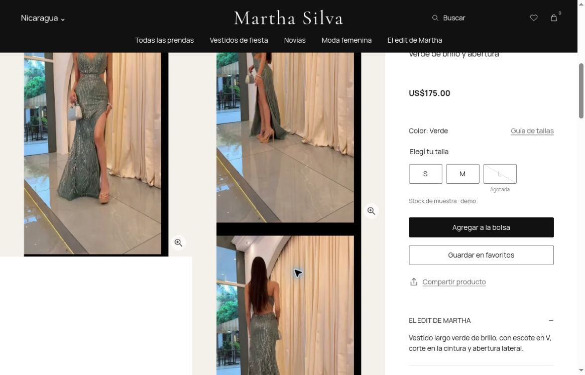
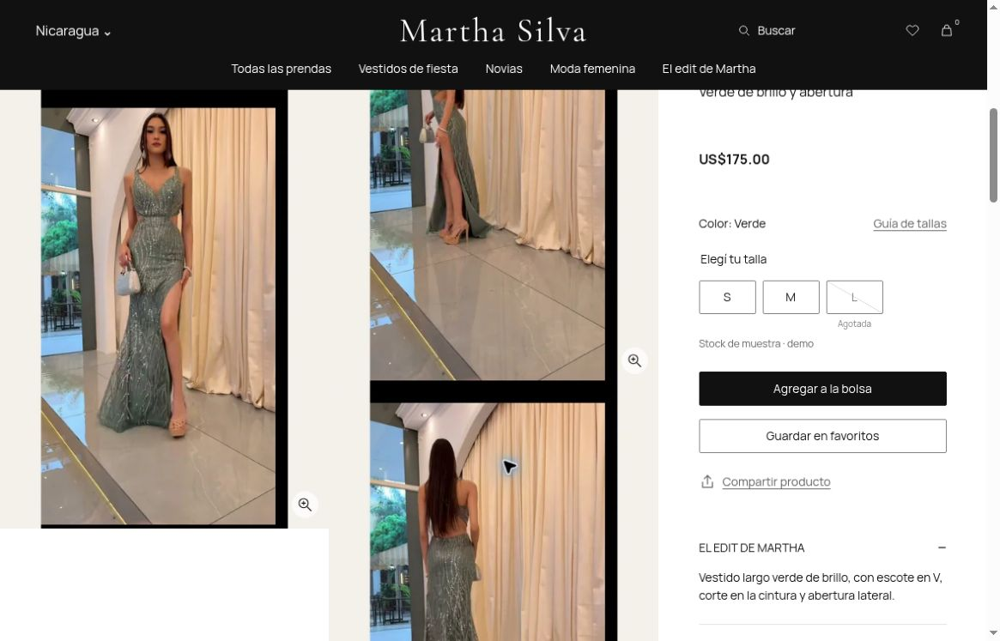

# Foto verde: antes y después

[Producto publicado](https://martha-silva-preview.martha-silva-denis.workers.dev/producto-verde-brillo-cuello-cruzado?lang=es).

Comparación del mismo viewport real de Chrome: 1180×757, DPR 1, escala 1 y
scrollY 757. La imagen seleccionada y el tamaño del marco permanecen iguales.

| Medición en píxeles CSS | Antes (e9e9609) | Después (704b2e1) |
| --- | ---: | ---: |
| Borde inferior de la cabecera | 106 | 106 |
| Inicio de la foto principal | 0 | 106 |
| Altura tapada por la cabecera | 106 | 0 |
| Ancho × alto del marco | 388.328125 × 517.765625 | 388.328125 × 517.765625 |

| Antes | Después |
| --- | --- |
|  |  |

Las capturas originales del proveedor son 1165×747; se conservan sin redimensionar.
Las medidas anteriores proceden del DOM, no de contar píxeles de las capturas.
Los archivos y sus SHA-256 están en [el manifiesto](live/comparison-manifest.json).

Pasaron 145 casos automatizados en cloud y 13 comprobaciones posteriores en el
navegador: foto completa bajo la cabecera, navegación de galería, compartir por
teclado con enlace/foco verificados y aislamiento respecto a otro producto.

Este ajuste no recorta ni mejora los píxeles de la fotografía. El borde incluido
en el archivo, la toma G2 y el desenfoque de origen siguen fuera de este corte.
No se comprobó visualmente móvil ni el límite de altura en una ventana baja.
